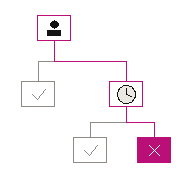

<p align="center">
  
</p>
<h1 align="center">CallSieve</h1>
<p align="center">Keep the calls you want. Give everything else a rule.</p>
<p align="center">
  <a href="https://github.com/lejlot/prod-callsieve/actions/workflows/ci.yml"></a>
</p>
<p align="center"><a href="https://github.com/lejlot/prod-callsieve/tree/v3.1"><strong>v3.1</strong></a> · Android 10+ · Calls &amp; SMS · On-device processing</p>

## What it does

| Your rule | Your choice |
| --- | --- |
| Who can reach you | Contacts, individual numbers, and countries |
| When they can reach you | Working hours, overnight schedules, and repeat callers |
| What happens next | Allow, silence, or block calls; keep or filter texts |

Build separate visual trees for calls and SMS. Follow each Yes or No branch, preview a number's route, then save.

## Get started

1. Install a signed CallSieve APK on an Android phone with telephony support.
2. Select CallSieve as your caller-ID and spam app. Grant Contacts access if your rules use your address book.
3. Build and save your call rules. To filter texts, also select CallSieve as your default SMS app.

## Build

JDK **17** · Android SDK **36** · Build Tools **35.0.0**

Set `ANDROID_HOME` to your Android SDK directory, then run:

```sh
./gradlew :app:assembleRelease :app:lintRelease
```

On Windows, use `gradlew.bat`. The unsigned APK is written to `app/build/outputs/apk/release/`; sign it before installation.

## Privacy & compatibility

CallSieve runs on your phone without an account or internet permission. Country rules use the displayed caller number, which can be spoofed. Android controls which calls reach screening. Text SMS is supported; MMS and RCS are not.

## Checks & notices

[CI](https://github.com/lejlot/prod-callsieve/actions/workflows/ci.yml) builds the release, runs Android lint, and scans source for secrets on pushes and pull requests. Third-party license notices are in [licenses/](licenses/).
